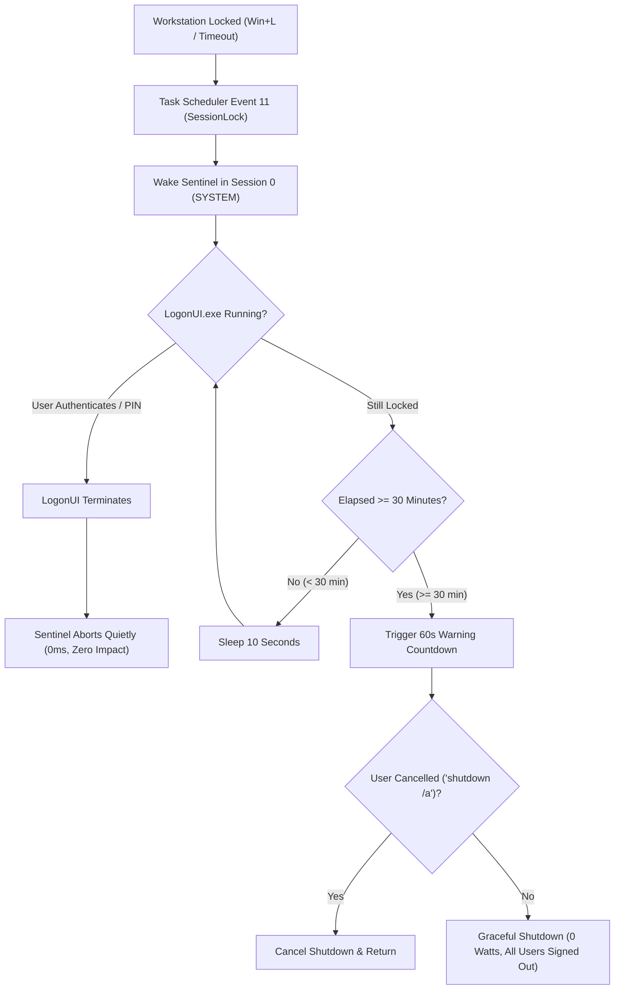

# 🛡️ workstation-sentinel

> **Zero-overhead, event-driven Windows sentinel that automatically powers off unattended workstations after 30 minutes of lock inactivity.**

[](https://github.com/karansinghverma/workstation-sentinel)
[](https://github.com/karansinghverma/workstation-sentinel)
[](https://github.com/karansinghverma/workstation-sentinel)
[](LICENSE)
[](docs/architecture.md)

---

## ⚡ The Problem

* **Multi-User Memory Hogging**: On shared workstations, when one user walks away or switches user, their 50 browser tabs and heavy background apps remain trapped in RAM.
* **Modern Standby & Sleep Drain**: Windows Sleep frequently fails to prevent battery drain or keep laptops cool in bags overnight.
* **No Built-in Inactivity Shutdown**: Windows natively supports screen timeouts and sleep timers, but has no built-in mechanism to gracefully power off a workstation if left locked and abandoned.

---

## 🧠 How It Works

`workstation-sentinel` is purely **event-driven**. While you are actively working, it consumes **0% CPU and 0 MB RAM**.



1. **Instant Cancel on Unlock**: The moment you unlock the PC or type your PIN, Windows terminates `LogonUI.exe`. The sentinel detects this and **aborts immediately**.
2. **Clean Slate**: On shutdown, all user sessions (`karan`, `mitra`, etc.) and background memory leaks are cleanly closed. Next boot starts fresh at the login screen.
3. **Emergency Cancel**: Displays a 60-second native Windows warning before powering off. Type `shutdown /a` in any terminal to cancel.

---

## 🚀 Quickstart

### 1. Installation
Clone the repository and run the installer from PowerShell:

```powershell
git clone https://github.com/karansinghverma/workstation-sentinel.git
cd workstation-sentinel
powershell -ExecutionPolicy Bypass -File .\install.ps1
```
*(Accept the standard Windows UAC elevation prompt to register the task in Windows Task Scheduler).*

---

## 🛠️ CLI Operations

### Check Live Lock Status
```powershell
powershell -ExecutionPolicy Bypass -File .\sentinel.ps1 -Status
```

### Dry Run (Test Mode)
Simulates a 15-second lock countdown with zero risk of shutdown:
```powershell
powershell -ExecutionPolicy Bypass -File .\sentinel.ps1 -Test
```

### Emergency Abort
If the 60-second shutdown warning appears on screen:
```cmd
shutdown /a
```

### Uninstall / Remove
To completely unregister and remove the sentinel:
```powershell
powershell -ExecutionPolicy Bypass -File .\uninstall.ps1
```

---

## 📚 Deep Documentation

For detailed technical references, refer to the documentation suite in [`docs/`](docs/):

* 🏛️ [**Architecture & Session Topology**](docs/architecture.md): Sequence diagrams, state machines, and Session 0 isolation details.
* ⚙️ [**Configuration & Tuning**](docs/configuration.md): Customizing countdown timers (15m/45m/60m), hibernate vs. shutdown, and display sync.
* 🩺 [**Troubleshooting & Diagnostics**](docs/troubleshooting.md): Step-by-step diagnostic tree, Task Scheduler Event Viewer tracking, and log inspection.

---

## 📁 Repository Structure

```text
workstation-sentinel/
├── .github/
│   ├── ISSUE_TEMPLATE/
│   │   ├── bug_report.yml          # GitHub bug report schema
│   │   └── feature_request.yml     # GitHub feature request schema
│   ├── workflows/
│   │   └── lint.yml                # CI syntax validation & PSScriptAnalyzer
│   └── pull_request_template.md    # PR review checklist
├── docs/
│   ├── architecture.md             # Detailed Win32 topology & sequence diagrams
│   ├── configuration.md            # Timeout tuning & power policy alignment
│   └── troubleshooting.md          # Diagnostics & Event Viewer guide
├── .gitattributes                  # Enforces proper CRLF/LF line endings
├── .gitignore                      # Traps runtime logs and OS caches
├── CHANGELOG.md                    # Keep a Changelog semantic release history
├── CONTRIBUTING.md                 # Open-source contributing guidelines
├── LICENSE                         # MIT License
├── README.md                       # Root documentation & quickstart
├── SECURITY.md                     # Security policy & privilege boundary specs
├── install.ps1                     # Self-elevating Task Scheduler installer
├── register_task.xml               # SessionLock event trigger definition
├── sentinel.ps1                    # Core lock monitoring engine
└── uninstall.ps1                   # Self-elevating uninstaller
```

---

## 📄 License
Released under the [MIT License](LICENSE).  
Copyright © 2026 Karan Singh Verma.
