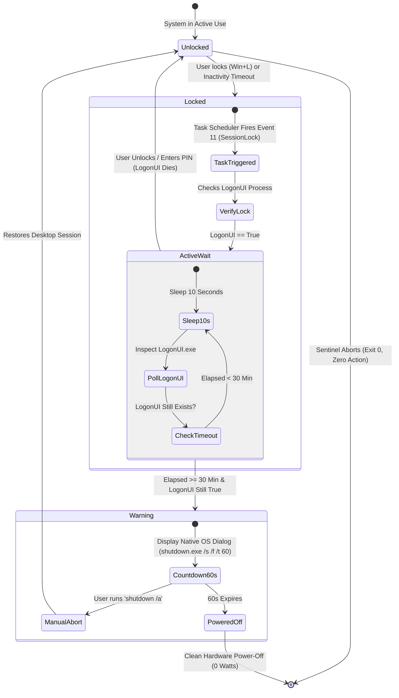
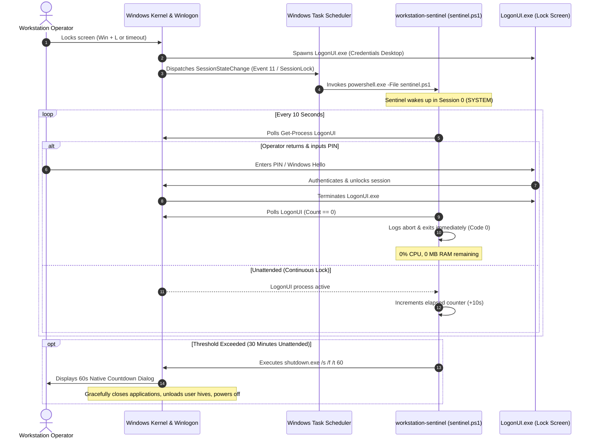

# 🏛️ Architecture & Internal Mechanics

This document provides a deep technical breakdown of the Windows session topology, event lifecycle, and process telemetry behind `workstation-sentinel`.

---

## 1. High-Level State Diagram

The lifecycle of `workstation-sentinel` is purely event-driven and transitions through discrete execution states:

---

## 2. Event Sequence Diagram

---

## 3. Windows Session Topology & The Session 0 Problem

### Interactive vs. Service Isolation
Since Windows Vista, Microsoft enforces **Session 0 Isolation**:
* **Session 0**: Reserved exclusively for background system services and scheduled tasks running as `NT AUTHORITY\SYSTEM`. GUI interactive surfaces are strictly prohibited in Session 0.
* **Session 1, 2, ...**: Interactive user console sessions hosting `explorer.exe`, client applications, and desktop windows.

### Why Generic Desktop API Checks Fail in Session 0
Many naive implementations attempt to call `user32.dll!OpenInputDesktop` or check `explorer.exe` bound to `[Process]::GetCurrentProcess().SessionId`. 

When a task runs as `NT AUTHORITY\SYSTEM`, its own process lives in **Session 0**:
* An inspection for `explorer.exe` in Session 0 returns **$null** because no shell runs in Session 0.
* If a script assumes *no explorer = locked*, it creates a catastrophic false positive, shutting down the computer while a user is actively typing in Session 2!

### The `LogonUI.exe` Invariant (Ground Truth)
`workstation-sentinel` resolves this by querying the global process table for **`LogonUI.exe`**:
1. When any console session is unlocked, `LogonUI.exe` does not exist on the machine.
2. The instant `Win + L` is pressed or the screen timeout triggers, `winlogon.exe` spawns `LogonUI.exe` to host the PIN/Password tiles.
3. The instant the user authenticates, `LogonUI.exe` is terminated by the OS.
4. Cross-session querying for `LogonUI.exe` works seamlessly from `NT AUTHORITY\SYSTEM` with zero session boundary conflicts.

---

## 4. Multi-User Fast User Switching Dynamics

In a shared PC environment with multiple accounts (e.g., `karan` and `mitra`):

| Action | Session 1 (`karan`) | Session 2 (`mitra`) | `LogonUI.exe` Status | Sentinel Decision |
| :--- | :--- | :--- | :---: | :--- |
| **Mitra working** | Disconnected | Active Desktop | **Absent (0)** | Sentinel will **never** trigger shutdown. |
| **Mitra clicks "Switch User"** | Disconnected | Disconnected | **Active (1)** | Sentinel starts 30-minute countdown. |
| **Karan logs in at minute 5** | Active Desktop | Disconnected | **Absent (0)** | Sentinel detects `LogonUI` death and **aborts immediately**. |
| **Both walk away (Lock screen)** | Disconnected | Disconnected | **Active (1)** | Sentinel counts full 30 mins $\rightarrow$ Clean Shutdown. |

---

## 5. Power State Telemetry

`workstation-sentinel` configures the Task Scheduler XML with:
* `<DisallowStartIfOnBatteries>false</DisallowStartIfOnBatteries>`
* `<StopIfGoingOnBatteries>false</StopIfGoingOnBatteries>`

This ensures the sentinel functions identically whether the laptop is plugged into AC power or running on battery DC power, preventing battery exhaustion from forgotten lock sessions.
